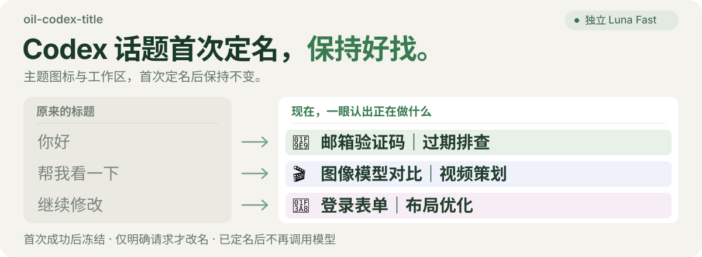

# oil-codex-title · 个人版

<p align="center">
  
</p>

给 Codex 的话题起一个容易认出的名字。**首次成功定名后永久保留，只有你明确要求时才重新命名。** 后续聊天、规则升级和工作区变化都不会自动改动标题，也不会继续调用命名模型。

基于 [oil-oil/oil-codex-title](https://github.com/oil-oil/oil-codex-title) 的个人 fork；当前版本 **0.2.0-personal.1（预览版）**。

## 一眼看出正在做什么

以下为命名效果示例：

| 原来的标题 | 更容易找回的标题 |
| --- | --- |
| 讨论录音 | 🎙️ DemoRecorder｜录音转写（本地项目） |
| 帮我研究 | 📈 Example Holdings｜估值分析（投资研究） |
| 检查网络 | 🌐 DemoRoute｜代理路由（网络配置） |
| 整理签到 | 🎁 Example Rewards｜签到积分（abcdefghij...） |

统一采用 **「主题 emoji + 对象｜目标（工作区）」**，先找对象，再看目标和所属工作区。

- **对象准确**：保留对话里明确的产品名、公司名和内容对象，减少目录名造成的误删。
- **图标更具体**：保留原有 8 种类别，新增 🏷️ 命名分类、🎙️ 录音转写、📈 投资研究、🌐 网络代理、🎁 签到积分。
- **一次定名**：没有实质内容时暂不定名；成功写入并核验后冻结。已有成功命名记录的旧话题也冻结，升级不批量补图标或后缀。
- **工作区清楚**：使用 Codex 侧栏的真实项目名称；明确未关联时写“本地项目”。名称最多显示 10 个英文字符的宽度，约等于 5 个汉字；超出后加 `...`，例如 `中文项目甲乙` 显示为 `中文项目甲...`。
- **跟随你的语言**：首次命名参考用户实质需求的主要语言，保留产品名。
- **后台生成**：独立 Luna Fast 生成核心标题；首次定名前，主代理需要读取一次宿主工作区元数据。这会增加工具调用，定名后停止。
- **由你控制**：可以预览新标题、固定喜欢的名称，也可以随时暂停或恢复自动命名。
- **可选闲置归档**：定期收起长期未聊、已经完成的话题，保护置顶与待办。先预览再开启；已归档话题不再参与模型评估，相同内容也不会每天重复判断。

## 让 Codex 帮你安装

复制下面这段话发给 Codex：

```text
帮我查找 GitHub 仓库 amanayayatu-tech/oil-codex-title，安装 0.2.0-personal.1 完整插件，保留已有配置和标题记录，开启首次命名后冻结的规则。检查 UserPromptSubmit 与 Stop 两个 Hook、官方宿主 list_threads/list_projects 工具及实际命名流程；需要我在界面中信任 Hook 时，请告诉我具体操作。
```

安装后，在新话题里正常聊天即可。默认使用 Luna Fast，消耗当前 Codex 账号的模型额度。工作区读取失败时保留原标题，等待后续正常轮次，不猜工作区名称。

## 日常怎么用

直接对 Codex 说：

- “预览这个话题的新标题。”
- “按新的目标重新命名这个话题。”（仅这次明确请求可以改已定名标题）
- “固定这个话题的标题。”
- “暂停自动命名。” / “恢复自动命名。”
- “预览可以归档的闲置话题。” / “每天帮我整理闲置话题。”

目前为**预览版**；程序回归、模型案例和桌面自然触发分别记录在验收文档中。需要本地 Codex 和官方宿主项目工具，云端暂不支持。部分桌面版本的置顶列表可能仍显示旧标题，可让 Codex“检查真实标题并同步桌面显示”。

[详细使用与数据说明](docs/使用与边界.md) · [归档规则](docs/归档工作流.md) · [兼容性与验证记录](docs/发布验收.md) · [MIT 许可证](LICENSE)
